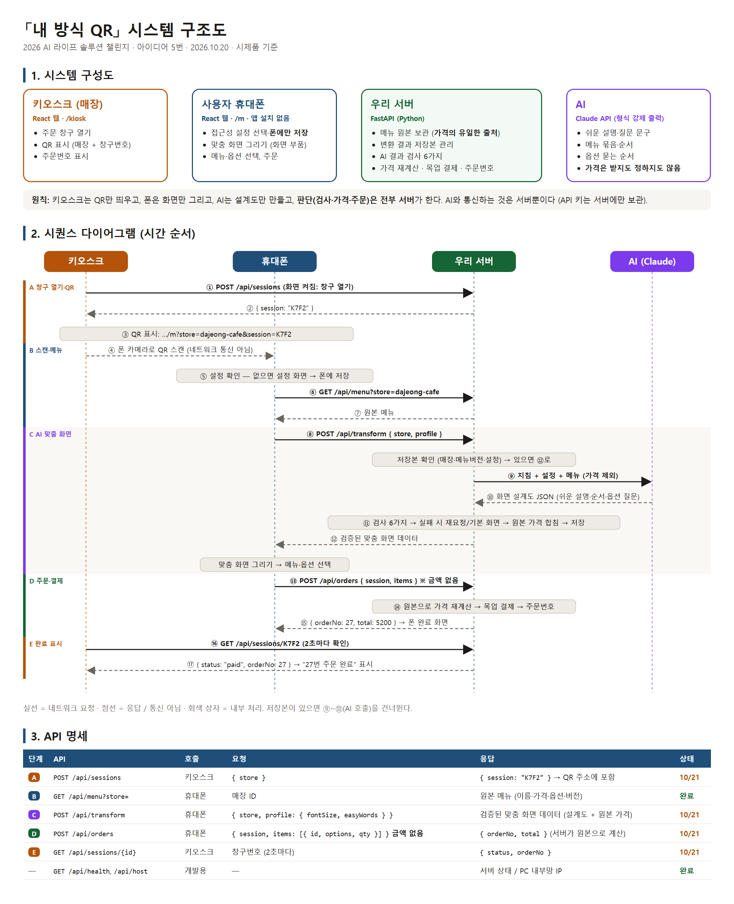

# 내 방식 QR — 범용 접근성 프로필 패스

> 2026 AI 라이프 솔루션 챌린지 · 아이디어 5번 구현

키오스크를 이용하기 어려운 사람이 **키오스크에 뜬 QR을 휴대폰으로 스캔**하면,
**AI가 사용자의 접근성 설정(큰 글씨·큰 버튼·쉬운 설명·고대비)에 맞춰 만든 주문 화면**이 휴대폰에서 열리는 웹 시제품입니다.

## 이용 흐름
1. 카페 키오스크 화면에 QR 코드가 표시됩니다.
2. 사용자가 휴대폰으로 QR을 스캔합니다.
3. (처음 한 번) 내 접근성 설정을 고르면 휴대폰에 저장됩니다.
4. AI가 설정에 맞게 변환한 주문 화면이 열립니다.
5. 메뉴·옵션 선택 → 장바구니 → 목업 결제로 주문을 마칩니다.

## 시스템 구조


> 원본: [`docs/architecture.html`](docs/architecture.html) — 수정 후 Chrome 으로 다시 캡처

## AI가 하는 일
매장 원본 메뉴(가격 제외) + 사용자 설정(글씨 크기·쉬운 말)을 받아 **화면 설계도(JSON)**를 만듭니다.

| AI가 바꾸는 것 | 예 |
|---|---|
| 어려운 설명 → 쉬운 말 | `에스프레소+스팀밀크` → `진한 커피와 데운 우유를 섞어요` |
| 글씨 크기에 맞는 길이 | 아주 큰 글씨면 더 짧게 |
| 메뉴 묶음·순서 | `논커피` → `커피가 아닌 음료` |
| 옵션 질문 | `사이즈 R / L` → `어떤 크기로 드릴까요? 보통 크기 / 큰 크기` |

**서버 검사 8개** — 하나라도 틀리면 틀린 이유를 알려 주고 다시 시킴(최대 2번), 그래도 실패하면 원래 메뉴 화면
1. 형식 · 2. 원본 메뉴 모두 포함 · 3. 지어낸 메뉴 없음 · 4. 옵션 ID 일치 · 5. 문구에 가격 없음 ·
6. 글씨 크기별 길이 · 7. 어려운 말 없음 · 8. 꼭 남길 정보 포함(예: 딸기라떼 "차갑게만")

- 규칙: [`backend/app/ai_rules.py`](backend/app/ai_rules.py) · 변환·검사: [`backend/app/transform.py`](backend/app/transform.py)
- 모델: OpenAI `gpt-4o-mini` (Structured Outputs) · 같은 매장·같은 설정은 캐시, 서버 시작 시 미리 생성
- 성공률 측정: `backend\.venv\Scripts\python backend\scripts\check_transform.py 3`

## 구성
- `frontend/` — React + Vite: 키오스크(`/kiosk`), 설정(`/m/setup`), 폰 주문(`/m`), AI 변환 확인(`/lab`)
- `backend/` — FastAPI: 메뉴, 주문 창구, AI 화면 변환, 주문(목업 결제)
- `backend/app/data/stores/*.json` — 매장 메뉴. **파일만 추가하면 새 매장**
- 작업 규칙: [`AGENTS.md`](AGENTS.md)

## 실행 방법 (개발용)
터미널 2개를 열어 각각 실행합니다.

```powershell
# 1) 서버 (최초 1회: python -m venv backend\.venv ; backend\.venv\Scripts\pip install -r backend\requirements.txt
#          backend\.env.example 을 backend\.env 로 복사하고 OPENAI_API_KEY 입력)
cd backend
.venv\Scripts\python -m uvicorn app.main:app --host 0.0.0.0 --port 8010

# 2) 화면 (최초 1회: npm install)
cd frontend
npm run dev
```

- PC: http://localhost:5180 (키오스크 `/kiosk`, AI 변환 확인 `/lab`)
- 폰(같은 와이파이): http://<PC의 IP>:5180/m

## 배포 (공개 테스트 URL)
`Dockerfile` 하나로 화면과 API 를 **주소 하나**로 올린다. 주문 창구·주문번호를 서버 메모리에 보관하므로 **서버는 반드시 1대**
(Vercel 같은 서버리스는 요청마다 다른 서버가 받을 수 있어 맞지 않음).

Render 무료 기준:
1. GitHub 저장소 연결 → New **Web Service** → Runtime **Docker** → Instance **Free**
2. Environment 에 `OPENAI_API_KEY` 입력 (파일·코드에 쓰지 않음). `ALLOW_FRESH=0` 은 Dockerfile 에 들어 있음
3. 무료 서버는 15분 동안 접속이 없으면 잠든다 → [cron-job.org](https://cron-job.org) 에서 `https://<주소>/api/health` 를 10분마다 호출
4. 확인: `https://<주소>/kiosk` 를 PC 에 띄우고 폰으로 QR → 주문 → 키오스크에 주문번호

- 수상 후에는 Render 요금제만 유료로 바꾸면 된다 (잠들지 않음, 코드 변경 없음)
- 서버가 다시 켜지면 열려 있던 창구는 사라지지만 키오스크가 새 창구를 자동으로 연다
- `/kiosk?debug` 이면 QR 주소 글자를 보여 준다 (영상 촬영 때는 debug 없이)

## 상태
🚧 개발 중 (2026-10-20 시작)
- ✅ 키오스크 QR · 설정 화면 · 주문 창구/주문 API · AI 화면 변환(검사 8개) · 폰 메뉴 적용
- ✅ 옵션(한 화면 한 질문) → 주문 목록 → 목업 결제 → 완료 · 배포 설정(Dockerfile)
- ⏳ 실제 배포(테스트 URL) · 두 번째 매장 · 사용자 테스트
